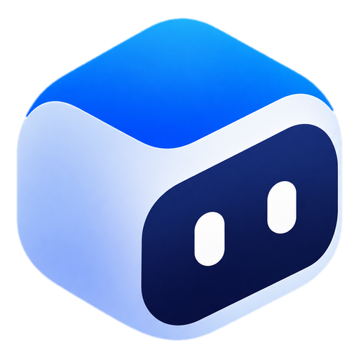
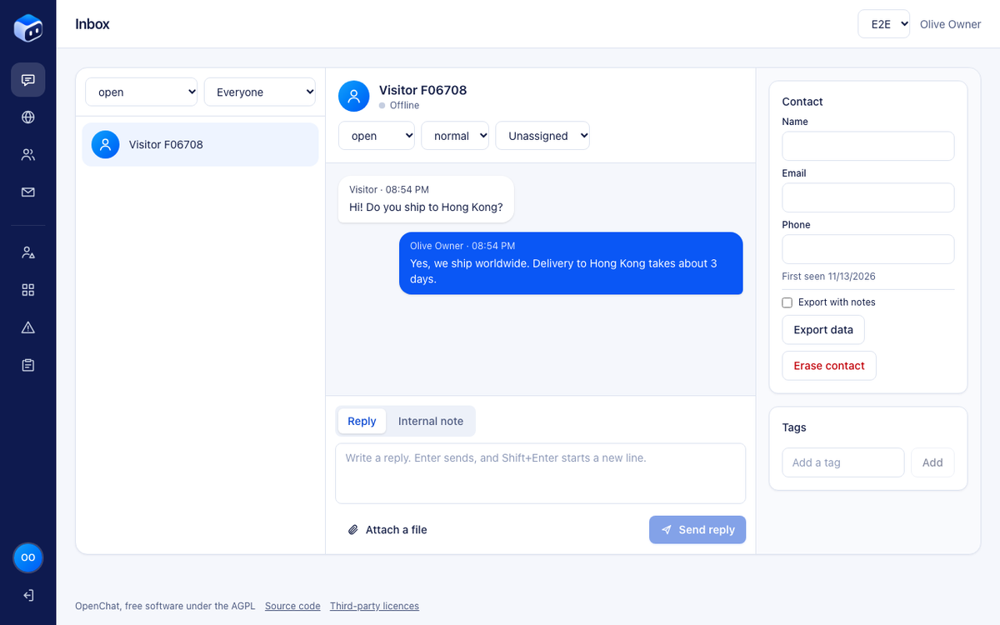
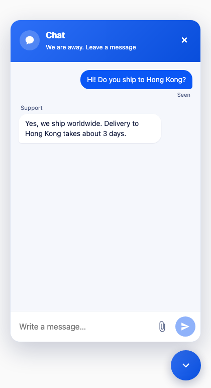

  

<h1 align="center">OpenChat</h1>

  <strong>Your chat. Your cloud.</strong> 
  Open-source customer chat that runs entirely in your own Cloudflare account.

  <a href="https://openchat.run">Website</a> ·
  <a href="docs/operations/self-hosting.md">Self-host</a> ·
  <a href="docs/guide/README.md">User guide</a> ·
  <a href="docs/known-issues.md">Known issues</a>

  
  
  
  

  
  &nbsp;
  

A chat button for your website, a team inbox on the web and on iPhone, and follow-up emails to visitors who go quiet. Each company runs its own installation, so its conversations stay in its own account.

- **Website widget.** About 2 KB to load, in eleven languages, with optional consent mode and Cloudflare Turnstile.
- **Team inbox.** Live replies, internal notes, files, statuses, priorities, assignment and tags, across several workspaces.
- **The OpenChat iPhone app**, with notifications end-to-end encrypted to each phone, so the relay that carries them cannot read them. The app and the relay are not open source, but your installation works with them.
- **Follow-up emails**, only with the visitor's consent, with an unsubscribe link.
- **For operators:** one-command deploy and upgrade with rollback, backups, health checks, retention, data export and erasure, and an audit log.

**Status: before 1.0.** It works, and has been tested on real Cloudflare, but has not had an independent security review, and the official iPhone app is not on the App Store yet. Read the [known issues](docs/known-issues.md) before relying on it.

## Start

| You want to | Read |
|---|---|
| Run it for your company | [Self-hosting guide](docs/operations/self-hosting.md) |
| Use it: answer chats, administer it, add the widget | [User guide](docs/guide/README.md) |
| Know what is not done yet | [Known issues](docs/known-issues.md) |
| Understand how it works, or contribute | [Documentation index](docs/README.md), [CONTRIBUTING.md](CONTRIBUTING.md), [AGENTS.md](AGENTS.md) |
| Use the icon, or match the colours | [Design system](docs/architecture/design-system.md) |
| Report a vulnerability | [SECURITY.md](SECURITY.md), privately |

## Licence

The server, dashboard and CLI are under AGPL-3.0-or-later. The widget and the client libraries are under Apache-2.0. The iPhone app and the notification relay are not open source ([ADR-0019](docs/architecture/decisions/0019-app-and-relay-leave-open-source.md)); this repository has the server's side of push. See [LICENSE](LICENSE) and [licensing](docs/operations/licensing.md). The original brief is in [REQUIREMENTS.md](REQUIREMENTS.md).
